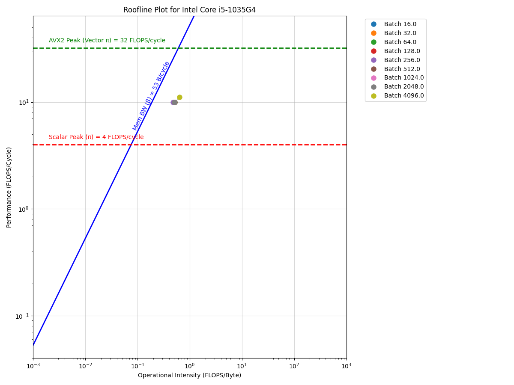

# Roofline Plot

## Usage

From base directory, run:

```bash
cd roofline
python
>>> from roofline_plot import RooflinePlot; plotter = RooflinePlot(); csv = 'dummy_data.csv';  plotter.plot(csv)
```

Make sure to have dependenncies installed:

```bash
pip install matplotlib pandas
```

## Output

Example output:

